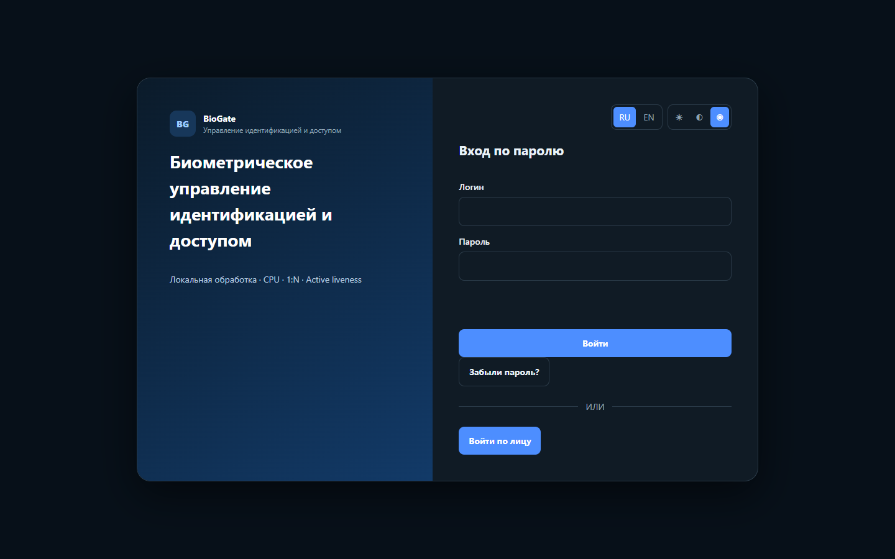
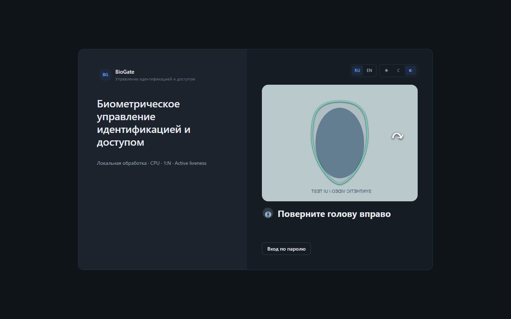
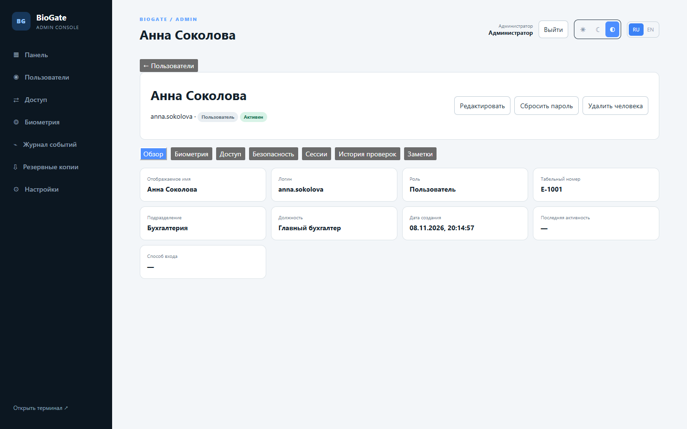

# BioGate V3

[](https://github.com/zamusikmain/biogate/actions/workflows/ci.yml)
[](LICENSE)

**[Русский](#русский)** · **[English](#english)**

---

# Русский

**Локальный вход по лицу (1:N) с активной проверкой живости. Проект показывает, как делать биометрическую
аутентификацию аккуратно: без облака, без доверия браузеру и с настоящим удалением человека из системы.**

## 1. Что это и зачем

Демо входа по лицу обычно доверяют браузеру, сравнивают с одним заранее заданным человеком и хранят все фото
вечно. BioGate — система идентификации на одной машине, которая делает «скучные» части правильно: кто решает,
что проверка живости пройдена; что происходит, когда два человека похожи; как меняется биометрический шаблон;
как биометрия удаляется.

BioGate V3 — автономная local-first система биометрической идентификации и управления доступом. Она объединяет:
вход по паролю, вход по лицу без выбора аккаунта, отдельное приложение пользователя (USER), консоль
администратора (ADMIN), обновление биометрии через одобрение, хранение фото-доказательств, журналы аудита и
безопасности, локальный backup/restore.

Работает на Windows, на CPU, с SQLite. Не требует облачных API, платных сервисов, Docker или Kubernetes.

> Активная проверка живости — демонстрационный механизм, а не сертифицированный PAD (Presentation Attack
> Detection). BioGate не заявляет соответствия GDPR, ISO или требованиям к продакшн-безопасности.

## 2. Скриншоты





_Сняты в тестовом стенде UI: камера показывает синтетическое видео, а не человека, все аккаунты вымышлены._

## 3. Возможности

- Единая страница входа: пароль, вход по лицу 1:N, восстановление пароля по лицу.
- Роли `USER` и `ADMIN`; статусы аккаунта `ACTIVE`, `BLOCKED`, `DISABLED`.
- Пароли в Argon2id, единая политика паролей, ограничение неудачных попыток, временные пароли, обязательная смена
  пароля при первом входе, сброс пароля администратором.
- Серверные сессии: непрозрачные подписанные HttpOnly cookie, `SameSite=Strict`, CSRF, абсолютный срок жизни,
  тайм-аут бездействия, данные устройства, выход и отзыв сессий.
- Локальная идентификация 1:N с настраиваемым порогом и отрывом Top-1/Top-2.
- Явные решения `IDENTIFIED`, `UNKNOWN`, `AMBIGUOUS`, `BLOCKED`, `DISABLED`.
- Поиск дубликатов биометрии до одобрения нового шаблона.
- Процесс обновления биометрии: `PENDING_REVIEW`, `APPROVED`, `REJECTED`, `REVISION_REQUIRED`, `CANCELLED`.
- Выборочные фото-доказательства событий доступа и заявок на биометрию; непрерывное видео не пишется.
- Активное хранение фото настраиваемый срок (`BIOGATE_ACTIVE_IMAGE_DAYS`, по умолчанию 60 дней), затем архив.
- Полное удаление человека по запросу: аккаунт, шаблоны, образцы, файлы фото и идентифицирующие данные событий.
- Проверка целостности фото по SHA-256, оповещения безопасности, защищённые эндпоинты фото.
- События доступа и безопасности, аудит, уведомления, сессии, таймлайн пользователя, внутренние заметки админа.
- Живой монитор доступа для ADMIN по SSE, экспорт CSV, создание/проверка backup и восстановление с явным
  подтверждением и страховочной копией.
- Интерфейс RU/EN с переключением на лету, темы Светлая/Тёмная/Системная во всех трёх интерфейсах.
- Аддитивная идемпотентная миграция SQLite V2 → V3.
- Детерминированный движок риска по правилам (не ML).
- Воспроизводимый бенчмарк точности на LFW.

## 4. Стек технологий

| Слой | Технологии |
| --- | --- |
| Язык | Python 3.11–3.13 (CI на 3.11 и 3.13) |
| Веб-фреймворк | FastAPI 0.162, Starlette 1.10, Uvicorn 0.54, Pydantic 2.14, pydantic-settings, Jinja2 |
| Компьютерное зрение | OpenCV contrib 4.10 (YuNet — детекция, SFace — выравнивание и эмбеддинги), MediaPipe 1.0 (Face Landmarker — моргание и поза), NumPy 2.2 |
| Безопасность | argon2-cffi (Argon2id), HMAC-подписанные cookie, CSRF-токены |
| База данных | SQLite (`data/biogate.db`), миграции при старте, `PRAGMA user_version=3` |
| Frontend | Чистый JavaScript + HTML-шаблоны Jinja2 + CSS, без сборки |
| Тесты и качество | pytest 9, pytest-cov (порог 80 %), Node-тесты UI, ruff, mypy `--strict` |
| CI | GitHub Actions (Windows, Python 3.11 и 3.13), Dependabot |
| Запуск | `Start.bat` → `scripts/run.ps1` (venv, зависимости, `.env`, сервер, браузер) |

## 5. Архитектура

```text
Браузер
  ├─ Вход / приложение USER / консоль ADMIN
  ├─ загружает НЕзеркальные JPEG (зеркалится только превью)
  ▼
FastAPI
  ├─ аутентификация аккаунтов + серверные сессии + CSRF + RBAC
  ├─ проверка живости, которой владеет сервер
  ├─ идентификация 1:N / целевая проверка 1:1 при восстановлении
  ├─ процесс одобрения биометрии
  ├─ фото-доказательства, архив, целостность, backup
  └─ аудит, доступ, безопасность, уведомления
  ▼
SQLite + защищённое локальное хранилище (data/)
```

**CV-пайплайн:** детекция лица OpenCV YuNet → выравнивание и эмбеддинг OpenCV SFace → геометрия моргания
MediaPipe Face Landmarker → фильтры по размытию, освещению, числу и размеру лиц → калибровка нейтральной позы
`CENTER` → физические повороты `TURN_LEFT`/`TURN_RIGHT` → моргание «открыт → закрыт → открыт» → случайная
последовательность от сервера, кадры стабильности, пауза между шагами, срок жизни.

**Ключевые решения:**

1. **Живость решает сервер.** Он выдаёт случайную последовательность (`CENTER`, `BLINK`, `TURN_LEFT`,
   `TURN_RIGHT`), следит за шагом, кадрами стабильности и сроком, и никогда не принимает флаг «живость пройдена»
   от браузера. LEFT/RIGHT — физические направления головы относительно откалиброванного центра; превью
   зеркальное, отправляемый кадр — нет.
2. **Совпадение = порог + отрыв.** Лучший кандидат должен пройти косинусный порог SFace (0.363) и опередить
   второго на настраиваемый отрыв. Иначе результат `UNKNOWN` или `AMBIGUOUS`, сессия не создаётся.
3. **Шаблоны меняются только через ревью.** Новый шаблон проверяется на дубликаты среди других людей, ждёт
   ADMIN и атомарно заменяет старый при одобрении; до этого старый продолжает работать.
4. **Приватность — это функция.** Всё на локальном диске, шаблоны не покидают API, пароли и токены хранятся
   только в виде хешей, срок хранения настраивается, один запрос удаляет аккаунт, шаблоны, образцы и фото,
   оставляя только псевдонимные записи аудита.

## 6. Структура проекта

```text
app/
  main.py                 FastAPI-приложение, HTML-страницы (/, /user, /admin), редиректы старых ссылок
  api/
    routes.py             /health, /health/live, /health/ready
    dependencies.py       зависимости: сессия, CSRF, роли
    event_safety.py       очистка метаданных событий от секретов
    v3/                   API V3 (/api/v3): auth, user, admin_accounts, admin_events, admin_system, evidence
    v3_enrollment.py      регистрация биометрии админом (/api/v3/admin/accounts/{id}/enrollment/*)
  core/                   config.py (настройки из .env), logging.py (JSON-логи, ротация файла)
  db/database.py          схема SQLite и миграции
  schemas/                Pydantic-схемы API (api.py, v3.py)
  services/
    biometrics/           detection, embedding, landmarks, liveness, quality, pipeline, model_store
    account_auth.py       пароли, сессии, политика паролей
    face_login.py         вход по лицу; challenges.py — испытания живости
    identification.py     сравнение 1:N и 1:1
    biometric_workflow.py заявки на обновление биометрии
    maintenance.py        архивация фото, очистка снимков, проверка диска
    rate_limit.py         лимиты попыток (в SQLite, ключи — HMAC)
    risk.py               движок риска по правилам
    storage.py            фото-доказательства, целостность, backup/restore
    repository/           доступ к данным: accounts, biometrics, events, evidence, stats
  static/                 JS/CSS: login-v3.js, user-v3.js, admin-v3.js, face-guidance.*, локали, темы
  templates/              login.html, user.html, admin.html
evaluation/               бенчмарк LFW: lfw.py, run.py, metrics.py, models.py, plots.py
scripts/                  run.ps1, bootstrap_env.py, generate_admin_hash.py, profile_liveness.py
tests/                    pytest + tests/ui (Node-тесты UI и QA-сервер)
docs/                     EVALUATION.md, NETWORK.md, MANUAL_TODO.md, evaluation/, img/
data/                     БД, фото, архив, backup, логи (не в Git)
model_cache/              скачиваемые CV-модели (не в Git)
```

## 7. Модель данных (SQLite)

| Таблица | Что хранит |
| --- | --- |
| `users` | Аккаунты: логин, ФИО, роль, статус, хеш пароля, флаги способов входа |
| `biometric_templates` | Активный шаблон человека (центроид эмбеддингов), один на пользователя |
| `biometric_template_samples` | До 5 представительных эмбеддингов на шаблон |
| `biometric_requests`, `biometric_request_samples` | Заявки на обновление биометрии и их образцы |
| `biometric_history` | История изменений биометрии |
| `account_sessions` | Серверные сессии (хеш токена, сроки, устройство, отзыв) |
| `access_events` | События входа/доступа |
| `security_events` | События безопасности и их разбор |
| `audit_events` | Аудит действий |
| `evidence_photos` | Метаданные фото-доказательств (UUID, SHA-256, состояние хранения и целостности) |
| `notifications` | Уведомления пользователю |
| `admin_notes` | Внутренние заметки админа о пользователе |
| `password_reset_authorizations` | Одноразовые разрешения на сброс пароля (только хеш токена) |
| `rate_limit_events` | Счётчики лимитов попыток (ключи — HMAC) |
| `backups` | Реестр резервных копий |
| `app_settings` | Настройки, меняемые из консоли |
| `verification_attempts`, `verification_sessions`, `attempt_snapshots` | Исторические данные V2 |

## 8. API

Документация OpenAPI — `/docs`. Документируются только `/api/v3/*` и `/health`.

| Группа | Эндпоинты |
| --- | --- |
| Здоровье | `GET /health`, `GET /health/live`, `GET /health/ready` |
| Аутентификация | `POST /api/v3/auth/password`, `GET /api/v3/auth/me`, `POST /api/v3/auth/logout`, `POST /api/v3/auth/change-password` |
| Вход по лицу | `POST /api/v3/face/challenges`, `POST /api/v3/face/challenges/{id}/frames` |
| Восстановление | `POST /api/v3/recovery/challenges`, `POST /api/v3/recovery/reset` |
| Сессии | `GET /api/v3/sessions`, `DELETE /api/v3/sessions/{id}` |
| Пользователь | `GET /api/v3/user/profile`, `GET /api/v3/user/access-events`, `GET /api/v3/user/notifications`, `POST /api/v3/user/notifications/{id}/read`, `POST /api/v3/user/biometric-frame`, `POST/GET/DELETE /api/v3/user/biometric-request(s)` |
| Админ: аккаунты | `POST/GET /api/v3/admin/accounts`, `GET/PATCH/DELETE /api/v3/admin/accounts/{id}`, `.../timeline`, `.../biometric`, `.../notes`, `.../reset-password`, `.../force-password-change`, `.../sessions`, `.../access-events`, `.../security-events` |
| Админ: регистрация лица | `POST /api/v3/admin/accounts/{id}/enrollment/validate`, `POST /api/v3/admin/accounts/{id}/enrollment/photos` |
| Админ: заявки на биометрию | `GET /api/v3/admin/biometric-requests`, `GET .../{id}`, `POST .../{id}/review` |
| Админ: события | `GET /api/v3/admin/access-events` (+ `.csv`), `GET /api/v3/admin/security-events`, `POST .../{id}/review`, `GET /api/v3/admin/audit-events`, `GET /api/v3/admin/unknown-faces`, `GET /api/v3/admin/events/{category}/{id}` |
| Админ: система | `GET /api/v3/admin/dashboard`, `GET /api/v3/admin/system-health`, `GET/PUT /api/v3/admin/settings`, `GET /api/v3/admin/live` (SSE) |
| Фото и архив | `GET /api/v3/photos/{id}`, `GET /api/v3/photos/{id}/download`, `GET /api/v3/admin/archive`, `POST /api/v3/admin/archive/run`, `POST /api/v3/admin/archive/{id}/verify` |
| Backup | `POST/GET /api/v3/admin/backups`, `GET .../{id}/validate`, `POST .../{id}/restore`, `DELETE .../{id}` |

Страницы: `/` — единый вход, `/user` — приложение пользователя, `/admin` — консоль. Старые ссылки
`/admin/login`, `/admin/users/{id}`, `/admin/verifications/{id}` перенаправляются.

## 9. Как работает

### Вход по лицу и идентификация 1:N

Пользователь нажимает «Войти по лицу», не выбирая аккаунт. Сервер создаёт случайное испытание живости. После
него принятые эмбеддинги кадров усредняются в памяти и сравниваются со всеми шаблонами аккаунтов `ACTIVE`,
`BLOCKED`, `DISABLED`. Решение использует порог `BIOGATE_IDENTIFICATION_THRESHOLD` (0.363) и отрыв
`BIOGATE_IDENTIFICATION_AMBIGUITY_MARGIN` между Top-1 и Top-2. Ниже порога — `UNKNOWN`, близкие Top-1/Top-2 —
`AMBIGUOUS`; сессия не выдаётся. Уверенно узнанный заблокированный аккаунт даёт своё решение, фото, событие
доступа и оповещение безопасности, но без сессии. Кандидаты хранятся только в защищённых метаданных и не
раскрываются в ответе.

### Пароли и восстановление

Пароли хешируются Argon2id и никогда не возвращаются API. Политика едина для всех путей: не меньше 12 символов,
хотя бы одна строчная и одна заглавная ASCII-буква, цифра и спецсимвол (пробел не считается). Админ может задать
или сгенерировать временный пароль: хранится только хеш, сгенерированное значение показывается один раз,
включается `must_change_password`, сессии отзываются.

«Забыли пароль?» — целевой поток 1:1: пользователь вводит логин → ответ не раскрывает, существует ли аккаунт →
проходит проверку живости → сравнение только с шаблоном этого аккаунта → создаётся короткоживущее одноразовое
разрешение на сброс (хранится хеш) → успешный сброс отзывает все сессии и пишет аудит.

Лимиты: попытки паролей, старты восстановления и испытания лица ограничены по клиенту (по умолчанию 10 за
5 минут, затем HTTP 429 `FACE_LOGIN_RATE_LIMITED`); незавершённые испытания ограничены на клиента и на процесс
(`FACE_LOGIN_BUSY`). Счётчики хранятся в SQLite и переживают перезапуск.

### Сессии, CSRF и права

Cookie `biogate_session` содержит пару ID/токен и HMAC-подпись; в SQLite — только хеш токена. Все изменяющие
запросы требуют `X-CSRF-Token`. Права проверяет backend (скрытие кнопок в UI не считается авторизацией).
Пользователь видит только свои данные; фото лежат вне `static/` и отдаются после проверки прав. В системе всегда
остаётся хотя бы один активный ADMIN.

### Создание аккаунтов и администрирование

ADMIN создаёт аккаунты USER/ADMIN. Логины сравниваются с учётом регистра; уникальность логина, внешнего ID и
табельного номера гарантирует SQLite. Карточка пользователя: профиль, биометрия, события, сессии, таймлайн,
заметки, переключатели способов входа. Критичные изменения требуют причины, отзывают сессии и пишутся в аудит.
Таблицы с серверной пагинацией. Детали событий очищаются от идентификаторов сессий, токенов, хешей и векторов.

### Обновление биометрии

Пользователь отправляет 3–5 фото или кадров с камеры. Каждый кадр проверяется: MIME, размер, декодирование,
число лиц, размытие, освещение, выравнивание, эмбеддинг; для шаблонов дополнительно поза — поворот
(`BIOGATE_ENROLLMENT_MAX_YAW`, 0.35) и наклон (`BIOGATE_ENROLLMENT_MAX_ROLL_DEGREES`, 20°), ошибки
`HEAD_TURNED`/`HEAD_TILTED`. Кандидат проверяется на дубликаты. Шаблон хранит до пяти максимально различных
образцов; при сравнении берётся лучший балл из центроида и образцов. Старый шаблон работает до одобрения.

### Фото-доказательства и архив

Сохраняются выбранные кадры успешных и отклонённых входов, неизвестных лиц, заблокированных попыток,
восстановления и заявок. У каждого — UUID, MIME, размер, SHA-256, состояние. Файлы лежат в `data/active_images/`,
через `BIOGATE_ACTIVE_IMAGE_DAYS` дней переносятся в `data/archive/`. Обслуживание запускается при старте и каждые
`BIOGATE_MAINTENANCE_INTERVAL_SECONDS` (24 ч): архивирует, удаляет старые снимки V2, проверяет свободное место
(`BIOGATE_MIN_FREE_DISK_MB`). Несовпадение хеша → `INTEGRITY_FAILED` + критическое событие безопасности.
Логи — JSON-строки в консоль и, при `BIOGATE_LOG_FILE`, в ротируемый файл.

### Удаление человека

`DELETE /api/v3/admin/accounts/{id}` с `{"reason": "...", "confirmation": "ERASE"}` — только ADMIN, нельзя удалить
себя или последнего ADMIN, одна транзакция с `secure_delete`: удаляются аккаунт, сессии, разрешения, уведомления,
заметки, заявки, история, шаблоны и образцы, фото (активные и архивные); оставшиеся записи аудита и событий
обезличиваются; создаётся одна запись `ACCOUNT_ERASED`. **Старые backup не переписываются** — после удаления их
нужно удалить или хранить недолго; при восстановлении из старой копии удаления надо повторить.

### Backup и восстановление

ZIP с консистентной копией SQLite и фото + `manifest.json` (тип, версия схемы, размеры и SHA-256 файлов). `.env`
и секреты не включаются. Восстановление только с подтверждением `RESTORE`, после проверки архива, хешей, схемы и
`PRAGMA integrity_check`, и только после создания страховочной копии. Старые копии без манифеста отклоняются.

### Движок риска

Детерминированные правила (не ML) по техническим событиям безопасности: серии неудачных паролей, неизвестные
лица, провалы живости, злоупотребление восстановлением, попытки заблокированных аккаунтов, частые сбросы паролей.
Уровни `LOW`/`MEDIUM`/`HIGH`/`CRITICAL` с причиной.

### Подсказки камеры

Вход, регистрация админом и обновление биометрии используют общий компонент `FaceGuidance` (SVG-контур головы и
инструкции). Он не влияет на решения сервера. Анализ стартует сам, Cancel/Retry прерывают запросы.

## 10. Точность на LFW

Проверка 1:1 по протоколу **LFW View 2** (6000 пар, 10 фолдов) с продакшн-детектором YuNet и моделью SFace.
Подробно: [docs/EVALUATION.md](docs/EVALUATION.md), сырые результаты: [docs/evaluation/](docs/evaluation/).

| SFace, пары с найденными лицами (5999) | Значение |
|---|---|
| EER | 0.80 % |
| При рабочем пороге 0.363 | FAR 0.067 % (2/3000), FRR 1.53 % (46/2999) |
| Порог для FAR ≤ 1 % | 0.295 → FRR 0.77 % |
| Порог для FAR ≤ 0.1 % | 0.364 → FRR 1.53 % |
| Лица, не найденные YuNet | 1 из 7701 изображения |

Это новостные фото LFW, не веб-камера и не 1:N. Воспроизвести:

```powershell
.\.venv\Scripts\python.exe -m evaluation.lfw
.\.venv\Scripts\python.exe -m evaluation.run --model sface
```

## 11. Конфигурация (`.env`)

Шаблон — `.env.example`. Главные переменные:

| Переменная | По умолчанию | Назначение |
| --- | --- | --- |
| `BIOGATE_ADMIN_USERNAME` | `admin` | Логин первого администратора |
| `BIOGATE_ADMIN_PASSWORD_HASH` | — | Argon2id-хеш пароля первого админа (обязательно) |
| `BIOGATE_SESSION_SECRET` | — | Секрет подписи cookie, 32+ символа (обязательно) |
| `BIOGATE_ADMIN_COOKIE_SECURE` | `false` | Cookie только по HTTPS (включается за прокси) |
| `BIOGATE_DB_PATH` | `data/biogate.db` | Путь к БД |
| `BIOGATE_MODEL_CACHE` | `model_cache` | Папка CV-моделей |
| `BIOGATE_IDENTIFICATION_THRESHOLD` | `0.363` | Порог идентификации 1:N |
| `BIOGATE_IDENTIFICATION_AMBIGUITY_MARGIN` | `0.035` | Отрыв Top-1 от Top-2 |
| `BIOGATE_VERIFICATION_THRESHOLD` | `0.363` | Порог 1:1 |
| `BIOGATE_DUPLICATE_BIOMETRIC_THRESHOLD` | `0.55` | Порог дубликата биометрии |
| `BIOGATE_MIN_ENROLLMENT_FRAMES` | `3` | Минимум кадров для шаблона |
| `BIOGATE_MIN_FACE_PIXELS`, `BIOGATE_MIN_SHARPNESS`, `BIOGATE_MIN_BRIGHTNESS`, `BIOGATE_MAX_BRIGHTNESS` | 80, 55, 45, 215 | Фильтры качества кадра |
| `BIOGATE_ENROLLMENT_MAX_YAW`, `BIOGATE_ENROLLMENT_MAX_ROLL_DEGREES` | 0.35, 20 | Лимиты позы при регистрации |
| `BIOGATE_CHALLENGE_TTL_SECONDS`, `BIOGATE_CHALLENGE_COOLDOWN_MS` | 120, 550 | Срок испытания и пауза между шагами |
| `BIOGATE_HEAD_*` | см. `.env.example` | Калибровка и пороги поворота головы |
| `BIOGATE_ACCOUNT_SESSION_TTL_SECONDS`, `BIOGATE_ACCOUNT_SESSION_IDLE_SECONDS` | 28800, 1800 | Срок сессии и тайм-аут бездействия |
| `BIOGATE_PASSWORD_MIN_LENGTH` | `12` | Минимальная длина пароля |
| `BIOGATE_PASSWORD_LOGIN_*`, `BIOGATE_RECOVERY_*`, `BIOGATE_FACE_LOGIN_*` | см. `.env.example` | Лимиты попыток |
| `BIOGATE_ALLOW_FACE_LOGIN`, `BIOGATE_ALLOW_PASSWORD_LOGIN` | `true` | Включение способов входа |
| `BIOGATE_ACTIVE_IMAGE_DAYS` | `60` | Срок активного хранения фото |
| `BIOGATE_ATTEMPT_IMAGE_RETENTION_DAYS` | `7` | Срок хранения снимков V2 |
| `BIOGATE_ACTIVE_IMAGE_DIR`, `BIOGATE_ARCHIVE_DIR`, `BIOGATE_BACKUP_DIR`, `BIOGATE_ATTEMPT_IMAGE_DIR` | `data/...` | Папки хранилища |
| `BIOGATE_MAINTENANCE_INTERVAL_SECONDS` | `86400` | Интервал обслуживания |
| `BIOGATE_MIN_FREE_DISK_MB` | `1024` | Порог предупреждения о месте на диске |
| `BIOGATE_LOG_FILE`, `BIOGATE_LOG_MAX_BYTES`, `BIOGATE_LOG_BACKUP_COUNT` | `data/logs/biogate.log`, 10 МБ, 5 | Файл логов и ротация |
| `BIOGATE_MAX_IMAGE_SIZE` | `5242880` | Максимальный размер загружаемого фото |
| `BIOGATE_DEBUG` | `false` | Режим отладки |

Реальный `.env`, файлы SQLite, модели, фото, архивы и backup в Git не попадают.

## 12. Установка и запуск (Windows)

Нужен Python 3.11, 3.12 или 3.13.

```powershell
.\Start.bat
```

При первом запуске скрипт: создаёт `.venv`, ставит зависимости (повторно — только при изменении
`pyproject.toml`), создаёт `.env` из `.env.example`, дважды спрашивает пароль админа (хранит только Argon2id-хеш),
генерирует `BIOGATE_SESSION_SECRET`, запускает сервер (он докачает CV-модели в `model_cache/`) и открывает
`http://127.0.0.1:8000/`. Если порт 8000 занят — берёт свободный. Существующие значения `.env` не перезаписываются.

Без браузера: `powershell -ExecutionPolicy Bypass -File scripts\run.ps1` (`-Dev` — с тестовыми инструментами,
`-Port 8080` — другой порт, `-BehindProxy` — за TLS-прокси).

Вручную:

```powershell
py -3.13 -m venv .venv
.\.venv\Scripts\python.exe -m pip install -e ".[dev]"
.\.venv\Scripts\python.exe scripts\bootstrap_env.py
.\.venv\Scripts\python.exe -m uvicorn app.main:app --host 127.0.0.1 --port 8000
```

BioGate слушает только `127.0.0.1`. Для терминала на другом компьютере (камера в браузере работает только по
HTTPS или на `localhost`) нужен локальный TLS reverse proxy и запуск с `-BehindProxy` — шаги в
[docs/NETWORK.md](docs/NETWORK.md). Запускать с одним воркером uvicorn.

## 13. Проверки и тесты

```powershell
.\.venv\Scripts\python.exe -m pytest
.\.venv\Scripts\python.exe -m ruff check .
.\.venv\Scripts\python.exe -m ruff format --check .
.\.venv\Scripts\python.exe -m mypy --strict app scripts evaluation
Get-ChildItem app\static -Filter *.js | ForEach-Object { node --check $_.FullName }
```

177 pytest-тестов и 48 Node-тестов UI. Покрыты: поведение V2, семантика позы головы, аутентификация/CSRF/RBAC,
миграции, пороги и неоднозначность идентификации, блокировки, лимиты, политика паролей, локализация и темы,
заявки на биометрию, архив и целостность, backup, движок риска, метрики оценки, лимиты позы, фильтр OpenAPI.
CI (GitHub Actions) прогоняет всё на Windows с Python 3.11 и 3.13, покрытие ≥ 80 %.

Изолированный QA интерфейса: `.venv\Scripts\python.exe -m tests.ui.qa_server` → `http://127.0.0.1:8765/`
(синтетическое видео, временная БД). Реальную камеру, распознавание и живость нужно проверять вручную.

## 14. Ветки и статус

| Ветка | Что в ней |
| --- | --- |
| `main` | **Актуальный код** (2026-11-15 в него влита `docs/network-deployment`: всё из polish + работа в сети) |
| `docs/network-deployment` | Совпадает с `main` |
| `polish-1`, `polish-2` | Раунды полировки (уже в `main`) |
| `feature/anti-spoofing` | Anti-spoofing на MiniFASNet (ещё не в `main`) |
| `feature/arcface` | Сравнение с ArcFace R100 |
| `feature/admin-login-field`, `feature/face-login-rate-limit`, `feature/persistent-login-limits` | Поле логина админа, лимиты входа по лицу, лимиты в SQLite |
| `feature/maintenance`, `feature/remove-v2-login`, `feature/v3-admin-api`, `fix/admin-password-reset` | Обслуживание, удаление входа V2, новый admin API, исправление сброса пароля |
| `replay-pr1` | Повтор PR #1 |

**Статус:** работает локально. FAR/FRR измерены только на LFW; для веб-камеры и 1:N цифр нет. Живость —
демонстрация, не сертифицированный PAD. Распознавание и живость в автотестах проверяются через поддельный
пайплайн, реальную камеру — вручную.

## 15. Планы

- [ ] Решить вопрос с условиями использования LFW (см. `docs/MANUAL_TODO.md`).
- [ ] Выбрать рабочий порог: 0.363 (FAR ≤ 0.1 %) или 0.295 (FAR ≤ 1 %).
- [ ] Собрать согласованный датасет со своей камеры и измерить точность отдельно от LFW.
- [ ] Проверить лимиты позы при регистрации реальной камерой.
- [ ] Довести и влить `feature/anti-spoofing`.
- [ ] Добавить GIF входа по лицу (`docs/img/face-login.gif`).

## 16. Приватность и ограничения

Хранятся: агрегированные шаблоны, метаданные доступа, выбранные фото, фото заявок, фото неизвестных лиц, архив,
сессии, аудит. Не хранятся: непрерывное видео, пароли и токены в открытом виде, хеши и шаблоны в ответах API,
эмбеддинги в логах. SQLite и локальная ФС рассчитаны на один экземпляр (один воркер uvicorn); испытания живости
живут в памяти и теряются при перезапуске. Шаблоны, фото и backup хранятся на диске без шифрования. Архивные фото
хранятся до удаления человека — это осознанное решение о приватности.

---

# English

**Local face login (1:N) with active liveness, built to show how biometric authentication can be done carefully:
no cloud, no trusted client, and a real way to delete a person.**

## 1. What it is and why

Face login demos usually trust the browser, compare against one hard-coded person and keep every photo forever.
BioGate is a single-machine identity system that tries to get the unglamorous parts right: who decides that
liveness passed, what happens when two people look alike, how a template is changed, and how biometric data is
removed.

BioGate V3 is a standalone, local-first biometric identity and access management system. It combines password
authentication, face login without preselecting an account, a separate USER application, an ADMIN console,
approval-based biometric updates, evidence storage, audit/security events, and local backup/restore.

It runs on Windows, on CPU, with SQLite. No cloud API, paid service, Docker or Kubernetes is required.

> Active liveness is a demonstration mechanism, not certified Presentation Attack Detection (PAD). BioGate is not
> presented as regulatory, GDPR, ISO, or production security compliance.

## 2. Screenshots


_Captured from the UI test harness: the camera shows a synthetic test video, not a person, and every account is
fictional._

## 3. Features

- Unified login page with password login, 1:N face login, and biometric password recovery.
- `USER` and `ADMIN` roles; `ACTIVE`, `BLOCKED`, and `DISABLED` account states.
- Argon2id password hashes, one password policy, failed-login throttling, temporary passwords, mandatory
  first-login password change, and administrator reset.
- Persisted server-side sessions with opaque signed HttpOnly cookies, `SameSite=Strict`, CSRF validation, absolute
  expiry, idle timeout, device metadata, logout, and revocation.
- 1:N local identification with a configurable threshold and Top-1/Top-2 ambiguity margin.
- Explicit `IDENTIFIED`, `UNKNOWN`, `AMBIGUOUS`, `BLOCKED`, and `DISABLED` decisions.
- Duplicate-biometric detection before a candidate template can be approved.
- Biometric update workflow: `PENDING_REVIEW`, `APPROVED`, `REJECTED`, `REVISION_REQUIRED`, `CANCELLED`.
- Selected evidence photos for access and biometric-request events; no continuous video.
- Active evidence storage for a configurable period (`BIOGATE_ACTIVE_IMAGE_DAYS`, default 60) followed by archival.
- Complete erasure of a person on request: account, templates, samples, evidence files, identifying event data.
- SHA-256 evidence integrity checks, security alerts, and protected photo endpoints.
- Access events, security events, audit history, notifications, sessions, user timelines, internal admin notes.
- ADMIN live access monitor over SSE, CSV export, backup creation/validation, and confirmed restore with a safety
  backup.
- Live Russian/English switching and Light/Dark/System themes across all three interfaces.
- Additive, idempotent V2 → V3 SQLite migration.
- Deterministic rule-based risk engine (not ML).
- Reproducible LFW accuracy benchmark.

## 4. Tech stack

| Layer | Technologies |
| --- | --- |
| Language | Python 3.11–3.13 (CI on 3.11 and 3.13) |
| Web | FastAPI 0.162, Starlette 1.10, Uvicorn 0.54, Pydantic 2.14, pydantic-settings, Jinja2 |
| Computer vision | OpenCV contrib 4.10 (YuNet detection, SFace alignment and embeddings), MediaPipe 1.0 (Face Landmarker: blink and pose), NumPy 2.2 |
| Security | argon2-cffi (Argon2id), HMAC-signed cookies, CSRF tokens |
| Database | SQLite (`data/biogate.db`), migrations at startup, `PRAGMA user_version=3` |
| Frontend | Plain JavaScript + Jinja2 HTML templates + CSS, no build step |
| Tests and quality | pytest 9, pytest-cov (80 % gate), Node UI tests, ruff, mypy `--strict` |
| CI | GitHub Actions (Windows, Python 3.11 and 3.13), Dependabot |
| Launch | `Start.bat` → `scripts/run.ps1` (venv, dependencies, `.env`, server, browser) |

## 5. Architecture

```text
Browser
  ├─ Login / USER UI / ADMIN UI
  ├─ unmirrored JPEG uploads (preview alone is mirrored)
  ▼
FastAPI
  ├─ account auth + persisted sessions + CSRF + RBAC
  ├─ server-owned liveness challenge
  ├─ 1:N identification / targeted 1:1 recovery
  ├─ biometric approval workflow
  ├─ evidence, archive, integrity, backup
  └─ audit, access, security, notifications
  ▼
SQLite + protected local storage (data/)
```

**CV pipeline:** OpenCV YuNet face detection → OpenCV SFace alignment and embedding → MediaPipe Face Landmarker
blink geometry → blur, lighting, face-count and face-size gates → neutral `CENTER` calibration → physical
`TURN_LEFT`/`TURN_RIGHT` mapping → `BLINK` open → closed → open → randomized backend-owned sequence, stability
frames, cooldown and expiry.

**Key decisions:**

1. **The server owns liveness.** It issues a random sequence (`CENTER`, `BLINK`, `TURN_LEFT`, `TURN_RIGHT`), tracks
   the step, stability frames and expiry, and never accepts a "liveness passed" flag from the browser. LEFT/RIGHT
   are physical head directions measured relative to a calibrated centre pose; the preview is mirrored, the uploaded
   frame is not.
2. **A match needs a threshold and a margin.** The best candidate must pass the SFace cosine threshold (0.363) and
   beat the second best by a configurable margin. Otherwise the result is `UNKNOWN` or `AMBIGUOUS` and no session
   is created.
3. **Templates change only through review.** A new template is checked for duplicates against other people, waits
   for an ADMIN, and replaces the old one atomically on approval; the old one keeps working until then.
4. **Privacy is a feature, not a footnote.** Everything stays on the local disk, templates never leave the API,
   passwords and tokens are stored only as hashes, retention is configurable, and one request erases a person's
   account, templates, samples and photos while keeping only pseudonymous audit records.

## 6. Project structure

```text
app/
  main.py                 FastAPI app, HTML pages (/, /user, /admin), legacy link redirects
  api/
    routes.py             /health, /health/live, /health/ready
    dependencies.py       session, CSRF and role dependencies
    event_safety.py       strips secrets from event metadata
    v3/                   V3 API (/api/v3): auth, user, admin_accounts, admin_events, admin_system, evidence
    v3_enrollment.py      admin biometric enrollment (/api/v3/admin/accounts/{id}/enrollment/*)
  core/                   config.py (settings from .env), logging.py (JSON logs, rotating file)
  db/database.py          SQLite schema and migrations
  schemas/                Pydantic API schemas (api.py, v3.py)
  services/
    biometrics/           detection, embedding, landmarks, liveness, quality, pipeline, model_store
    account_auth.py       passwords, sessions, password policy
    face_login.py         face login; challenges.py — liveness challenges
    identification.py     1:N and 1:1 matching
    biometric_workflow.py biometric update requests
    maintenance.py        evidence archival, snapshot cleanup, disk check
    rate_limit.py         attempt limits (in SQLite, HMAC keys)
    risk.py               rule-based risk engine
    storage.py            evidence, integrity, backup/restore
    repository/           data access: accounts, biometrics, events, evidence, stats
  static/                 JS/CSS: login-v3.js, user-v3.js, admin-v3.js, face-guidance.*, locales, themes
  templates/              login.html, user.html, admin.html
evaluation/               LFW benchmark: lfw.py, run.py, metrics.py, models.py, plots.py
scripts/                  run.ps1, bootstrap_env.py, generate_admin_hash.py, profile_liveness.py
tests/                    pytest + tests/ui (Node UI tests and QA server)
docs/                     EVALUATION.md, NETWORK.md, MANUAL_TODO.md, evaluation/, img/
data/                     database, evidence, archive, backups, logs (not in Git)
model_cache/              downloaded CV models (not in Git)
```

## 7. Data model (SQLite)

| Table | Contents |
| --- | --- |
| `users` | Accounts: login, full name, role, status, password hash, sign-in method flags |
| `biometric_templates` | A person's active template (embedding centroid), one per user |
| `biometric_template_samples` | Up to 5 representative embeddings per template |
| `biometric_requests`, `biometric_request_samples` | Biometric update requests and their samples |
| `biometric_history` | Biometric change history |
| `account_sessions` | Server-side sessions (token hash, expiry, device, revocation) |
| `access_events` | Sign-in/access events |
| `security_events` | Security events and their review |
| `audit_events` | Action audit |
| `evidence_photos` | Evidence metadata (UUID, SHA-256, storage and integrity state) |
| `notifications` | User notifications |
| `admin_notes` | Internal admin notes about a user |
| `password_reset_authorizations` | Single-use password reset authorizations (token hash only) |
| `rate_limit_events` | Attempt-limit counters (HMAC keys) |
| `backups` | Backup registry |
| `app_settings` | Settings changed from the console |
| `verification_attempts`, `verification_sessions`, `attempt_snapshots` | Historical V2 data |

## 8. API

OpenAPI docs at `/docs`. Only `/api/v3/*` and `/health` are documented.

| Group | Endpoints |
| --- | --- |
| Health | `GET /health`, `GET /health/live`, `GET /health/ready` |
| Authentication | `POST /api/v3/auth/password`, `GET /api/v3/auth/me`, `POST /api/v3/auth/logout`, `POST /api/v3/auth/change-password` |
| Face login | `POST /api/v3/face/challenges`, `POST /api/v3/face/challenges/{id}/frames` |
| Recovery | `POST /api/v3/recovery/challenges`, `POST /api/v3/recovery/reset` |
| Sessions | `GET /api/v3/sessions`, `DELETE /api/v3/sessions/{id}` |
| User | `GET /api/v3/user/profile`, `GET /api/v3/user/access-events`, `GET /api/v3/user/notifications`, `POST /api/v3/user/notifications/{id}/read`, `POST /api/v3/user/biometric-frame`, `POST/GET/DELETE /api/v3/user/biometric-request(s)` |
| Admin: accounts | `POST/GET /api/v3/admin/accounts`, `GET/PATCH/DELETE /api/v3/admin/accounts/{id}`, `.../timeline`, `.../biometric`, `.../notes`, `.../reset-password`, `.../force-password-change`, `.../sessions`, `.../access-events`, `.../security-events` |
| Admin: face enrollment | `POST /api/v3/admin/accounts/{id}/enrollment/validate`, `POST /api/v3/admin/accounts/{id}/enrollment/photos` |
| Admin: biometric requests | `GET /api/v3/admin/biometric-requests`, `GET .../{id}`, `POST .../{id}/review` |
| Admin: events | `GET /api/v3/admin/access-events` (+ `.csv`), `GET /api/v3/admin/security-events`, `POST .../{id}/review`, `GET /api/v3/admin/audit-events`, `GET /api/v3/admin/unknown-faces`, `GET /api/v3/admin/events/{category}/{id}` |
| Admin: system | `GET /api/v3/admin/dashboard`, `GET /api/v3/admin/system-health`, `GET/PUT /api/v3/admin/settings`, `GET /api/v3/admin/live` (SSE) |
| Evidence and archive | `GET /api/v3/photos/{id}`, `GET /api/v3/photos/{id}/download`, `GET /api/v3/admin/archive`, `POST /api/v3/admin/archive/run`, `POST /api/v3/admin/archive/{id}/verify` |
| Backups | `POST/GET /api/v3/admin/backups`, `GET .../{id}/validate`, `POST .../{id}/restore`, `DELETE .../{id}` |

Pages: `/` unified login, `/user` user app, `/admin` console. Legacy links `/admin/login`, `/admin/users/{id}`,
`/admin/verifications/{id}` redirect.

## 9. How it works

### Face login and 1:N identification

The user selects "Sign in with face" without choosing an account. The backend creates a randomized liveness
challenge. After completion, accepted frame embeddings are aggregated in memory and compared with all templates of
`ACTIVE`, `BLOCKED` or `DISABLED` accounts. The decision uses `BIOGATE_IDENTIFICATION_THRESHOLD` (0.363) and the
`BIOGATE_IDENTIFICATION_AMBIGUITY_MARGIN` between Top-1 and Top-2. Below threshold is `UNKNOWN`; a close
Top-1/Top-2 is `AMBIGUOUS`; neither gets a session. A confidently recognized blocked or disabled account gets its
policy decision, evidence, access event and security alert, without a session. Candidates are kept only in
protected security metadata and are not exposed in the response.

### Passwords and recovery

Passwords are Argon2id-hashed and never returned by the API. One policy applies everywhere: at least 12 characters
with an ASCII lowercase letter, an ASCII uppercase letter, a digit and a special character (whitespace does not
count). An admin can set or generate a temporary password: only the hash is stored, a generated value is shown
once, `must_change_password` is set and sessions are revoked.

"Forgot password?" is a targeted 1:1 flow: the user enters a login → the response does not reveal whether the
account exists → the user completes liveness → the aggregate is compared only with that account's template → a
short-lived single-use reset authorization is created (hash stored) → a successful reset revokes all sessions and
is audited.

Limits: password attempts, recovery starts and face challenges are limited per client (default 10 per 5 minutes,
then HTTP 429 `FACE_LOGIN_RATE_LIMITED`); unfinished challenges are capped per client and per process
(`FACE_LOGIN_BUSY`). Counters live in SQLite and survive restarts.

### Sessions, CSRF and authorization

The `biogate_session` cookie holds an ID/token pair plus an HMAC signature; SQLite stores only the token hash. Every
changing request needs `X-CSRF-Token`. The backend enforces permissions (hiding UI controls is not authorization).
Users see only their own data; evidence lives outside `static/` and is served after an authorization check. At least
one active ADMIN always remains.

### Account creation and administration

An ADMIN creates USER/ADMIN accounts. Logins are case-sensitive; SQLite enforces uniqueness of login, external ID
and employee ID. The User Card shows profile, biometrics, events, sessions, timeline, notes and sign-in method
switches. Critical changes need a reason, revoke sessions and are audited. Tables page on the server. Event details
are stripped of session IDs, tokens, hashes and vectors.

### Biometric updates

Users submit 3–5 photos or webcam frames. Each frame is checked for MIME, size, decodability, face count, blur,
lighting, alignment and embedding; template frames also pass a pose gate — yaw (`BIOGATE_ENROLLMENT_MAX_YAW`, 0.35)
and roll (`BIOGATE_ENROLLMENT_MAX_ROLL_DEGREES`, 20°), errors `HEAD_TURNED`/`HEAD_TILTED`. The candidate is checked
for duplicates. A template keeps up to five maximally different samples; matching uses the best score of the
centroid and samples. The old template works until approval.

### Evidence and archive

Selected frames of successful and denied sign-ins, unknown faces, blocked attempts, recovery and requests are stored
with UUID, MIME, size, SHA-256 and state. Files start in `data/active_images/` and move to `data/archive/` after
`BIOGATE_ACTIVE_IMAGE_DAYS`. Maintenance runs at startup and every `BIOGATE_MAINTENANCE_INTERVAL_SECONDS` (24 h):
archival, removal of old V2 snapshots, free-space check (`BIOGATE_MIN_FREE_DISK_MB`). A hash mismatch becomes
`INTEGRITY_FAILED` plus a critical security event. Logs are JSON lines on the console and, with `BIOGATE_LOG_FILE`,
in a rotating file.

### Erasing a person

`DELETE /api/v3/admin/accounts/{id}` with `{"reason": "...", "confirmation": "ERASE"}` — ADMIN only, cannot erase
yourself or the last ADMIN, one transaction with `secure_delete`: the account, sessions, authorizations,
notifications, notes, requests, history, templates, samples and photos (active and archived) are deleted; remaining
audit and event rows are de-identified; one `ACCOUNT_ERASED` record is written. **Existing backups are not
rewritten** — delete them after an erasure or keep them briefly; if an older backup is restored, repeat the
erasures.

### Backup and restore

A ZIP with a consistent SQLite copy and evidence + `manifest.json` (kind, schema version, sizes and SHA-256 of
files). `.env` and secrets are excluded. Restore requires the confirmation `RESTORE`, runs only after archive, hash,
schema and `PRAGMA integrity_check` validation, and only after a safety backup. Legacy backups without a manifest
are rejected.

### Risk engine

Deterministic rules (not ML) over technical security events: repeated failed passwords, unknown faces, liveness
failures, recovery abuse, attempts by blocked accounts, excessive resets. Levels `LOW`/`MEDIUM`/`HIGH`/`CRITICAL`
with a reason.

### Camera guidance

Login, admin enrollment and biometric updates share the `FaceGuidance` component (head-shaped SVG and
instructions). It never affects server decisions. Analysis starts automatically; Cancel/Retry abort requests.

## 10. Accuracy on LFW

1:1 verification on **LFW View 2** (6,000 pairs, 10 folds) with the production YuNet detector and SFace model.
Details: [docs/EVALUATION.md](docs/EVALUATION.md), raw results: [docs/evaluation/](docs/evaluation/).

| SFace, pairs where both faces were found (5,999) | Value |
|---|---|
| EER | 0.80 % |
| At the production threshold 0.363 | FAR 0.067 % (2/3,000), FRR 1.53 % (46/2,999) |
| Threshold for FAR ≤ 1 % | 0.295 → FRR 0.77 % |
| Threshold for FAR ≤ 0.1 % | 0.364 → FRR 1.53 % |
| Faces not found by YuNet | 1 of 7,701 images |

These are LFW news photos, not webcam images or 1:N identification. Reproduce:

```powershell
.\.venv\Scripts\python.exe -m evaluation.lfw
.\.venv\Scripts\python.exe -m evaluation.run --model sface
```

## 11. Configuration (`.env`)

Template: `.env.example`. Main variables:

| Variable | Default | Purpose |
| --- | --- | --- |
| `BIOGATE_ADMIN_USERNAME` | `admin` | First administrator login |
| `BIOGATE_ADMIN_PASSWORD_HASH` | — | Argon2id hash of the first admin password (required) |
| `BIOGATE_SESSION_SECRET` | — | Cookie signing secret, 32+ characters (required) |
| `BIOGATE_ADMIN_COOKIE_SECURE` | `false` | HTTPS-only cookie (enabled behind a proxy) |
| `BIOGATE_DB_PATH` | `data/biogate.db` | Database path |
| `BIOGATE_MODEL_CACHE` | `model_cache` | CV model folder |
| `BIOGATE_IDENTIFICATION_THRESHOLD` | `0.363` | 1:N threshold |
| `BIOGATE_IDENTIFICATION_AMBIGUITY_MARGIN` | `0.035` | Top-1 vs Top-2 margin |
| `BIOGATE_VERIFICATION_THRESHOLD` | `0.363` | 1:1 threshold |
| `BIOGATE_DUPLICATE_BIOMETRIC_THRESHOLD` | `0.55` | Duplicate biometric threshold |
| `BIOGATE_MIN_ENROLLMENT_FRAMES` | `3` | Minimum frames for a template |
| `BIOGATE_MIN_FACE_PIXELS`, `BIOGATE_MIN_SHARPNESS`, `BIOGATE_MIN_BRIGHTNESS`, `BIOGATE_MAX_BRIGHTNESS` | 80, 55, 45, 215 | Frame quality gates |
| `BIOGATE_ENROLLMENT_MAX_YAW`, `BIOGATE_ENROLLMENT_MAX_ROLL_DEGREES` | 0.35, 20 | Enrollment pose limits |
| `BIOGATE_CHALLENGE_TTL_SECONDS`, `BIOGATE_CHALLENGE_COOLDOWN_MS` | 120, 550 | Challenge lifetime and step cooldown |
| `BIOGATE_HEAD_*` | see `.env.example` | Head-turn calibration and thresholds |
| `BIOGATE_ACCOUNT_SESSION_TTL_SECONDS`, `BIOGATE_ACCOUNT_SESSION_IDLE_SECONDS` | 28800, 1800 | Session lifetime and idle timeout |
| `BIOGATE_PASSWORD_MIN_LENGTH` | `12` | Minimum password length |
| `BIOGATE_PASSWORD_LOGIN_*`, `BIOGATE_RECOVERY_*`, `BIOGATE_FACE_LOGIN_*` | see `.env.example` | Attempt limits |
| `BIOGATE_ALLOW_FACE_LOGIN`, `BIOGATE_ALLOW_PASSWORD_LOGIN` | `true` | Sign-in method switches |
| `BIOGATE_ACTIVE_IMAGE_DAYS` | `60` | Active evidence retention |
| `BIOGATE_ATTEMPT_IMAGE_RETENTION_DAYS` | `7` | V2 snapshot retention |
| `BIOGATE_ACTIVE_IMAGE_DIR`, `BIOGATE_ARCHIVE_DIR`, `BIOGATE_BACKUP_DIR`, `BIOGATE_ATTEMPT_IMAGE_DIR` | `data/...` | Storage folders |
| `BIOGATE_MAINTENANCE_INTERVAL_SECONDS` | `86400` | Maintenance interval |
| `BIOGATE_MIN_FREE_DISK_MB` | `1024` | Low disk space warning threshold |
| `BIOGATE_LOG_FILE`, `BIOGATE_LOG_MAX_BYTES`, `BIOGATE_LOG_BACKUP_COUNT` | `data/logs/biogate.log`, 10 MB, 5 | Log file and rotation |
| `BIOGATE_MAX_IMAGE_SIZE` | `5242880` | Maximum uploaded image size |
| `BIOGATE_DEBUG` | `false` | Debug mode |

The real `.env`, SQLite files, models, evidence, archives and backups are excluded from Git.

## 12. Setup and launch (Windows)

Requires Python 3.11, 3.12 or 3.13.

```powershell
.\Start.bat
```

On the first run the script creates `.venv`, installs dependencies (again only when `pyproject.toml` changes),
creates `.env` from `.env.example`, asks twice for the admin password (stores only the Argon2id hash), generates
`BIOGATE_SESSION_SECRET`, starts the server (which fetches CV models into `model_cache/`) and opens
`http://127.0.0.1:8000/`. If port 8000 is busy it picks a free one. Existing `.env` values are never overwritten.

Without the browser: `powershell -ExecutionPolicy Bypass -File scripts\run.ps1` (`-Dev` for test tools,
`-Port 8080` for another port, `-BehindProxy` behind a TLS proxy).

Manually:

```powershell
py -3.13 -m venv .venv
.\.venv\Scripts\python.exe -m pip install -e ".[dev]"
.\.venv\Scripts\python.exe scripts\bootstrap_env.py
.\.venv\Scripts\python.exe -m uvicorn app.main:app --host 127.0.0.1 --port 8000
```

BioGate listens on `127.0.0.1` only. For a terminal on another computer (browsers allow the camera only over HTTPS
or on `localhost`) put a local TLS reverse proxy in front and start with `-BehindProxy` — steps in
[docs/NETWORK.md](docs/NETWORK.md). Run a single uvicorn worker.

## 13. Checks and tests

```powershell
.\.venv\Scripts\python.exe -m pytest
.\.venv\Scripts\python.exe -m ruff check .
.\.venv\Scripts\python.exe -m ruff format --check .
.\.venv\Scripts\python.exe -m mypy --strict app scripts evaluation
Get-ChildItem app\static -Filter *.js | ForEach-Object { node --check $_.FullName }
```

177 pytest tests and 48 Node UI tests. They cover V2 behavior, head-pose semantics, authentication/CSRF/RBAC,
migration, identification threshold and ambiguity, blocked accounts, throttling, the password policy, localization
and themes, biometric requests, archival and integrity, backups, the risk engine, evaluation metrics, enrollment
pose limits and OpenAPI filtering. CI (GitHub Actions) runs everything on Windows with Python 3.11 and 3.13,
coverage ≥ 80 %.

Isolated UI QA: `.venv\Scripts\python.exe -m tests.ui.qa_server` → `http://127.0.0.1:8765/` (synthetic video,
temporary database). A real camera, recognition and liveness must be checked manually.

## 14. Branches and status

| Branch | Contents |
| --- | --- |
| `main` | **Current code** (on 2026-11-15 `docs/network-deployment` was merged in: all polish work + network use) |
| `docs/network-deployment` | Same as `main` |
| `polish-1`, `polish-2` | Polish rounds (already in `main`) |
| `feature/anti-spoofing` | MiniFASNet anti-spoofing (not in `main` yet) |
| `feature/arcface` | ArcFace R100 comparison |
| `feature/admin-login-field`, `feature/face-login-rate-limit`, `feature/persistent-login-limits` | Admin login field, face-login limits, limits in SQLite |
| `feature/maintenance`, `feature/remove-v2-login`, `feature/v3-admin-api`, `fix/admin-password-reset` | Maintenance, V2 login removal, new admin API, password reset fix |
| `replay-pr1` | Replay of PR #1 |

**Status:** works locally. FAR/FRR were measured only on LFW; there are no webcam or 1:N numbers. Liveness is a
demonstration, not certified PAD. Recognition and liveness are covered in automated tests through a fake pipeline;
a real camera must be checked manually.

## 15. Roadmap

- [ ] Decide on the LFW terms of use (see `docs/MANUAL_TODO.md`).
- [ ] Choose the production threshold: 0.363 (FAR ≤ 0.1 %) or 0.295 (FAR ≤ 1 %).
- [ ] Collect a consented webcam dataset and measure accuracy separately from LFW.
- [ ] Check the enrollment pose limits with a real camera.
- [ ] Finish and merge `feature/anti-spoofing`.
- [ ] Add a face-login GIF (`docs/img/face-login.gif`).

## 16. Privacy and limitations

Stored: aggregate templates, access metadata, selected evidence, request photos, unknown-face evidence, archives,
sessions, audit. Not stored: continuous video, plaintext passwords or tokens, hashes or templates in API responses,
embeddings in logs. SQLite and the local filesystem target a single instance (one uvicorn worker); liveness
challenges live in memory and are lost on restart. Templates, evidence and backups are stored unencrypted on disk.
Archived evidence is kept until the person is erased — a deliberate privacy decision.
